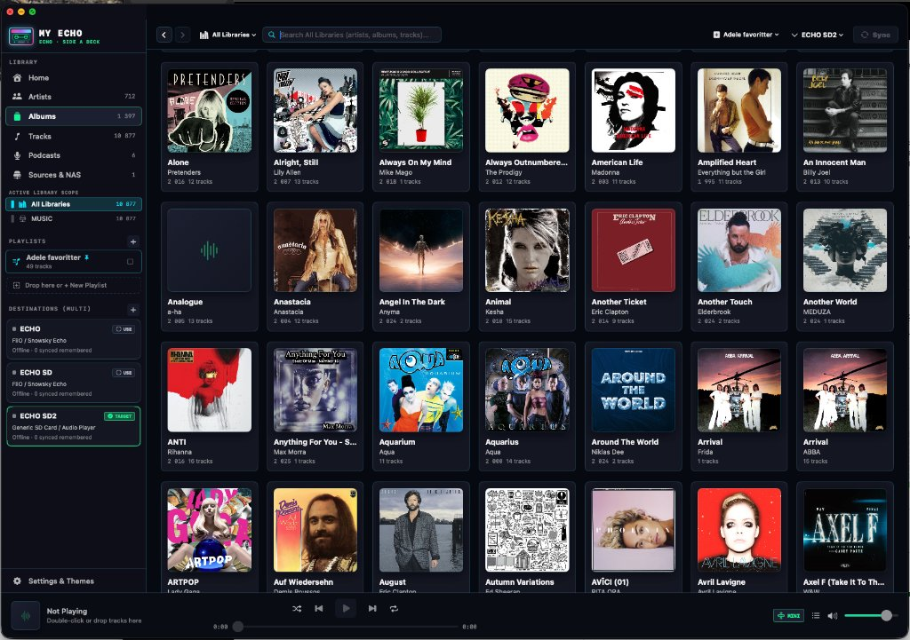
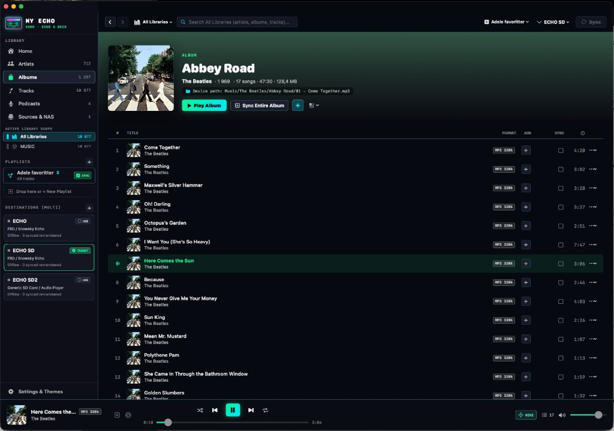
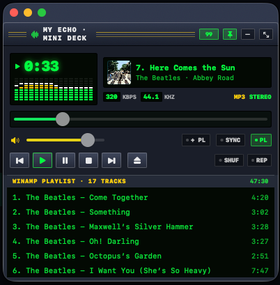

# My Echo — Native macOS Hi-Fi Music, Podcast & FiiO DAP Sync Studio

**My Echo** is a native Swift 6 / SwiftUI macOS application built for audiophiles and portable Digital Audio Player (DAP) owners. It combines a Spotify-familiar library browser, a 90s neon retro aesthetic (with 5 live-switchable hardware-inspired & frosted glass themes), a floating **Winamp-style Mini Player**, multi-directory podcast discovery & auto-rotating downloads, and a zero-dependency FiiO-aware sync engine that maintains strict `ARTIST/ALBUM/TRACK` storage structures on SD cards and audio players.

---

## Screenshots

### Albums Grid · Echo Cassette Theme & Multi-Destination Sidebar


### Album Detail · Dynamic Artwork Glow, `ARTIST/ALBUM/TRACK` Path Preview & Playback Bar


### Floating Winamp-Style Mini Player (`⌘⇧M`) · Live 16-Band Spectrum & Resizable `PL` Drawer
<p align="center">
  
</p>

---

## Releases & Download

Prebuilt macOS (Apple Silicon) `.app` bundles are published on the [**GitHub Releases**](https://github.com/baardove/my-echo/releases) page.

### Latest Release — [`v1.2.0`](https://github.com/baardove/my-echo/releases/tag/v1.2.0)

- **Download:** [`My-Echo-v1.2.0-macOS-arm64.zip`](https://github.com/baardove/my-echo/releases/download/v1.2.0/My-Echo-v1.2.0-macOS-arm64.zip) (2.8 MB, macOS 14+ Apple Silicon)
- **SHA-256 Checksum:** [`My-Echo-v1.2.0-macOS-arm64.zip.sha256`](https://github.com/baardove/my-echo/releases/download/v1.2.0/My-Echo-v1.2.0-macOS-arm64.zip.sha256)
  ```text
  354ddb31be91477d91519b1a6254158893b13acf2e8a8c1c4ddfb7386015af4b  My-Echo-v1.2.0-macOS-arm64.zip
  ```

#### Quick Install
1. Download and unzip `My-Echo-v1.2.0-macOS-arm64.zip`.
2. Drag **`My Echo.app`** into `/Applications`.
3. Verify checksum (optional):
   ```bash
   shasum -a 256 -c My-Echo-v1.2.0-macOS-arm64.zip.sha256
   ```
4. Because GitHub releases are ad-hoc signed (not notarized with a paid Apple Developer ID), if macOS Gatekeeper warns on first open, clear the quarantine attribute once:
   ```bash
   xattr -cr "/Applications/My Echo.app"
   ```
   *(Or build locally from source in ~20 seconds with `./build-app.sh`.)*

#### Release History
- **[`v1.2.0`](https://github.com/baardove/my-echo/releases/tag/v1.2.0)** — Initial public macOS release: multi-source local & NAS indexing, pure-Swift metadata/artwork optimizer (`ARTIST/ALBUM/TRACK` + Baseline RGB JPEG + ID3v2.3 + `.lrc` + `._*` cleanup), **FiiO Echo / Nano / Disc / Android DAP / Generic** profiles, Single & Multi-Destination sync memory, drag-and-drop playlists, multi-directory podcasts with per-show episode rotation, freely height-resizable Winamp Mini Player, `diskutil` Clean & Eject, and 5 live themes (including **Frosted Glass**).

---

## Highlights & Features

### 1. Multi-Source Library Indexing (Local & NAS)
- Index any number of **local directories**, external drives, or **mounted SMB/NFS NAS shares** (`/Volumes/...`).
- **Incremental SQLite Indexing:** Uses `(filePath, fileSize, modifiedAt)` caching in `~/Library/Application Support/Echo/echo.sqlite` so re-indexing large libraries is fast.
- **Offline NAS Resilience:** If a NAS volume is temporarily unmounted, tracks remain safely preserved (marked `OFFLINE`) without erasing your playlists or device sync selections.
- **Persistent Library Scope:** Pick **All Libraries** or lock into a single library source from the sidebar or top bar — exploring **Home**, **Artists**, **Albums**, **Tracks**, detail views, and **Global Search** stays strictly inside your selected library until you switch.
- **Scoped Global Search:** Type in the top-bar search box from any screen to search Artists, Albums, Tracks, and Playlists inside the active library (or subscribed Podcast shows & episodes when viewing Podcasts).

### 2. Pure-Swift Audio Metadata & Hi-Fi Parser
Built with zero third-party native library dependencies (`EchoCore`):
- **Supported Audio Formats:** `FLAC`, `MP3` (ID3v2.2 / v2.3 / v2.4 + ID3v1 fallback), `M4A` / `AAC` / `ALAC`, `WAV` (RIFF `fmt `, `LIST INFO`, embedded `id3`), `OGG` Vorbis (`METADATA_BLOCK_PICTURE` + Ogg granule duration), `APE` (APEv2 footer tags & binary cover art), `DSD` (`.dsf` / `.dff`), `AIFF`, `OPUS`, and `WMA` (with `AVFoundation` fallback).
- **Hi-Fi Quality Badges:** Automatically displays bit depth, sample rate, and bitrate (e.g., `FLAC 24-bit/96kHz`, `DSD64`, `ALAC`, `MP3 320k`).
- **Artwork & Lyrics Detection:** Extracts embedded cover art with automatic folder-art fallback (`cover.jpg`, `folder.jpg`, `front.jpg`, `album.jpg`, `.png`) and detects matching `.lrc` synced lyrics sidecar files.

### 3. Structured `ARTIST/ALBUM/TRACK` Sync & FiiO First-Class Optimizations
Whether you select a **whole artist**, a **whole album**, a **single track**, or a **playlist**, Echo always preserves the folder hierarchy on the player — even if only one track from an album is copied:

```text
<DeviceRoot>/
├── Music/
│   └── Pink Floyd/
│       └── The Dark Side of the Moon/
│           ├── 04 - Time.flac
│           ├── 04 - Time.lrc
│           └── folder.jpg
├── Podcasts/
│   └── Darknet Diaries/
│       ├── 2026-11-10 - Episode 150.mp3
│       └── folder.jpg
├── Road Trip.m3u
└── .echo-sync-manifest.json
```

- **FAT32 / exFAT & Unicode Safety:** Normalizes macOS NFD decomposed filenames to **Unicode NFC** (preventing broken accents on DAP firmware), strips FAT32-illegal characters (`: * ? " < > | / \`), trims trailing dots/spaces, and prefixes multi-disc albums cleanly (`2-06 - Comfortably Numb.mp3`).
- **On-the-Fly FiiO Album Art Optimization (Non-Destructive):** Original files in your library are never touched. Copied cover art is converted to strict **sRGB Baseline JPEG** (never progressive, never PNG/CMYK), resized to the device preset limit, and embedded directly into copied **FLAC** (`PICTURE` block, audio frames bit-exact) and **MP3** (clean **ID3v2.3** `APIC` with optional `COMM` comment stripping), plus an optional `folder.jpg` fallback.
- **macOS `._*` AppleDouble Hygiene & Clean Eject:** Writes files via raw POSIX I/O to avoid Finder/quarantine xattrs, recursively purges `._*` and `.DS_Store` files via POSIX `opendir`/`readdir` after every sync (fixing FiiO *"Format not supported"* and database scan crashes), and provides one-click **Clean ._* & Eject**.
- **Configurable Sync Modes (Per Destination):**
  - **Mirror Sync:** Copies selected tracks/podcasts/playlists and safely removes Echo-managed items that are no longer selected (pruning empty folders).
  - **Additive Copy:** Copies new/updated selections without deleting existing music (while still honoring per-podcast episode rotation).
- **Pre-Sync Diff Preview:** Inspect tracks/podcasts to copy, playlists to generate (with live M3U line preview), items to remove, unsupported format warnings, storage delta, and hardware track-cap telemetry before syncing.

### 4. Built-In Hardware Profiles

| Profile | Storage & Path Style | Album Art Target | M3U Playlist Format | Track Limit / Notes |
| --- | --- | --- | --- | --- |
| **FiiO / Snowsky Echo** | FAT32 (`Music/`, `Podcasts/`) | `600×600` Baseline RGB JPEG + `folder.jpg` | `D:\...` (MicroSD) or `C:\...` (internal `ECHO`), `\`, `.m3u` | **8,191** track gauge · ID3v2.3 + strips MP3 `COMM` · `FLAC/MP3/WAV/M4A/ALAC/OGG/APE/DSD` |
| **FiiO / Snowsky Nano** | FAT32/exFAT ≤256GB | `500×500` Baseline RGB JPEG + `folder.jpg` | `D:\...` `\`, `.m3u` | **8,191** track gauge · 0.91" OLED lightweight tags · `FLAC/MP3/WAV/M4A/ALAC/OGG/APE/DSD` |
| **FiiO / Snowsky Disc** | MicroSD up to 2TB (Ingenic Linux) | `1000×1000` Baseline RGB JPEG (≤1.35 MB) + `folder.jpg` | Relative `/`, `.m3u8` (`Playlists/`) | No 8k cap · `FLAC/MP3/WAV/M4A/ALAC/OGG/APE/DSD` |
| **FiiO Android DAP (M / JM)** | exFAT / FAT32 | `1000×1000` Baseline RGB JPEG + `folder.jpg` | Relative `/` or `/storage/external_sd/`, `.m3u8` | Wide format support (`+ AIFF, OPUS, WMA`) |
| **Generic SD Card / USB** | FAT32 / exFAT | `800×800` Baseline RGB JPEG + `folder.jpg` | Relative `/`, `.m3u` | Broad compatibility + macOS `._*` cleanup |

### 5. Single & Multi-Destination Syncing
Configure in **Settings (`⌘,`)**:
- **Single Destination Mode:** Automatically targets your primary player or SD card.
- **Multi-Destination Mode:** Manage multiple targets independently (e.g., `ECHO` internal storage + `ECHO SD` microSD + `FiiO Disc`). You explicitly select the active sync target from the top-bar dropdown or the one-click **`TARGET` / `USE`** pill on any sidebar device card without leaving your current view.
- **Remembered Sync Destinations:** Every track and podcast episode remembers which destination(s) it is assigned and synced to — persisted in SQLite and displayed via color-coded destination badges even while a player or SD card is unplugged.

### 6. Playlist Management & Drag-and-Drop
- **Focused Playlist & Song `+` Button:** Pin or pick a focused target playlist in the top bar; every song row (and the Now Playing bar) includes a dedicated **`+` / `✓`** button to add or remove tracks in one click.
- **Drag & Drop Everywhere:** Drag any song, album, artist, playlist, podcast show, or episode (with custom artwork drag previews) onto:
  - Sidebar playlists (copy tracks in)
  - **"Drop here or + New Playlist"** zone (auto-create & populate a new playlist)
  - Open playlist rows (reorder tracks via drag-and-drop)
  - Any **Player / SD Card** card in the sidebar (assign to sync on that destination)
  - The bottom **Player Bar** or **Winamp Mini Player** (enqueue for playback)
- **Playlist Sync Toggles:** Include/exclude playlists right from sidebar `SYNC` badges, the playlist header switch, or the Device Sync **Playlists** tab.

### 7. Podcasts — Multi-Directory Search, RSS, OPML & Episode Rotation
- **Multi-Directory Search:** Search across **All Directories** (Apple Podcasts + gPodder Open Directory combined), **Apple Podcasts**, **gPodder Open**, or **Featured Picks**, plus quick category/top-chart browse chips (*Featured*, *Top Charts*, *Technology*, *Music & Hi-Fi*, *Science*, *History*, *Comedy*, *True Crime*, *Nordic / NO*).
- **Direct RSS & OPML Import:** Paste any RSS/XML feed URL or bulk-import subscriptions from an `.opml` file exported by Apple Podcasts, Pocket Casts, Overcast, or AntennaPod.
- **Per-Podcast "Keep Latest N" Rotation:** Set `Keep: 1 / 2 / 3 / 5 / 10 / 15 / 25 / All` per podcast show. When newer episodes are synced, Echo automatically downloads them on the fly and removes older episodes beyond that show's keep limit from your player (in both Mirror and Additive modes).

### 8. Built-In Spotify-Style Player & Winamp Mini Player (`⌘⇧M`)
- **Bottom Player Bar:** Play/pause, prev/next, interactive scrub slider, volume/mute, shuffle, repeat (`Off / All / One`), and Up Next queue popover.
- **Floating Winamp Mini Player (`EchoAmp Mini`):** Launch via the **`MINI`** button in the player bar or `⌘⇧M`:
  - Classic phosphor LCD clock (click to toggle elapsed vs. remaining time)
  - Live **16-band segmented spectrum analyzer** with falling peak-hold LEDs driven by real `AVAudioPlayer` channel metering
  - `KBPS` / `KHZ` / `STEREO` telemetry strip and beveled transport controls (`⏮ ▶ ❚❚ ■ ⏭ ⏏`)
  - **Always-on-Top** floating pin, ultra-slim **Windowshade** mode, classic Winamp 99 vs. active theme skin toggle
  - Expandable, **freely height-resizable Winamp `PL` Queue drawer** (`300px` minimum height up to full screen) with drag-and-drop support

### 9. 90s Neon Retro UI & 5 Live Themes
Crisp **≤ 8px** corner geometry, icon-first controls backed by descriptive tooltips, and 5 instant-switch themes in **Settings (`⌘,`)**:
1. **Echo Cassette** — FiiO / Snowsky Echo cassette deck (cyber-mint, arcade cyan, laser magenta + animated cassette logo)
2. **Nano OLED** — FiiO / Snowsky Nano (matte jet CNC aluminum, tangerine orange, 0.91" OLED sky blue)
3. **Disc Metallic** — FiiO / Snowsky Disc (brushed dark titanium, prismatic CD cyan, OLED amber)
4. **Winamp 99 Classic** — 1999 Winamp 2.x (gunmetal chassis, pure black LCD, phosphor `#00FF41` green & VU yellow/orange)
5. **Frosted Glass** — Translucent macOS smoked glass (`NSVisualEffectView` behind-window vibrancy, specular ice rims, prism aqua & crystal cassette logo)

---

## Requirements

- **macOS 14.0 (Sonoma)** or later (Apple Silicon or Intel)
- **Swift 6.0+ / Xcode 16+** (for building from source)

---

## Building, Running & Testing

```bash
# Run the unit test suite (14 tests in EchoCoreTests)
swift test

# Build the release macOS .app bundle with custom 90s Neon Cassette AppIcon.icns
./build-app.sh

# Launch the built app
open "build/My Echo.app"
```

You can also open `Package.swift` directly in Xcode to build, run, or debug.

---

## Keyboard Shortcuts

| Shortcut | Action |
| --- | --- |
| `⌘O` | Add Music Folder / NAS Source |
| `⌘R` | Re-Index All Library Sources |
| `⌘⇧D` | Add Player / SD Card / Folder Destination |
| `⌘,` | Open Settings & Themes |
| `⌘P` | Play / Pause |
| `⌘→` / `⌘←` | Next / Previous Track |
| `⌘⇧M` | Open Floating Winamp Mini Player |

---

## Architecture & Project Structure

```text
Echo/
├── Package.swift                                      # SwiftPM package (EchoCore library + EchoApp + EchoCoreTests)
├── build-app.sh                                       # Release builder & 90s Neon Cassette AppIcon.icns generator
├── Sources/
│   ├── EchoCore/                                      # Pure-Swift core engine (UI-independent, unit-tested)
│   │   ├── Models/
│   │   │   ├── LibraryModels.swift                    # AudioFormat, LibrarySource, Track, AlbumGroup, ArtistGroup, Playlist
│   │   │   ├── DeviceModels.swift                     # DestinationMode, DevicePresetKind, DeviceProfile, SyncMode, M3U styles
│   │   │   └── PodcastModels.swift                    # PodcastDirectory, PodcastShow (episodesToKeep), PodcastEpisode
│   │   ├── Metadata/
│   │   │   ├── AudioMetadataReader.swift              # Native FLAC/MP3/OGG/WAV/DSF/APE binary parser + AVFoundation fallback
│   │   │   └── ArtworkCache.swift                     # Content-hashed artwork cache + sRGB Baseline JPEG converter/validator
│   │   ├── Indexing/
│   │   │   └── LibraryIndexer.swift                   # Incremental local & NAS scanner
│   │   ├── Podcasts/
│   │   │   └── PodcastService.swift                   # Apple + gPodder search, RSS 2.0 XML parser, OPML parser, downloader
│   │   ├── Persistence/
│   │   │   └── EchoDatabase.swift                     # Native SQLite3 WAL-mode store
│   │   ├── Playback/
│   │   │   └── AudioPlayerEngine.swift                # Queue, shuffle, repeat, and 16-band real-time audio metering
│   │   └── Sync/
│   │       ├── PathFormatter.swift                    # FAT32/NFC sanitization, ARTIST/ALBUM/TRACK, Podcasts, M3U/M3U8
│   │       ├── AudioFileCopyOptimizer.swift           # xattr-free copy + safe FLAC PICTURE & MP3 ID3v2.3 rewrite
│   │       ├── SyncEngine.swift                       # SyncPlanner, SyncEngine, DeviceSyncManifest, POSIX ._* cleaner
│   │       └── VolumeMonitor.swift                    # Removable volume detection & Clean-and-Eject
│   └── EchoApp/                                       # Native macOS SwiftUI interface
│       ├── EchoApp.swift                              # Main Studio & Winamp Mini Player scenes + menu commands
│       ├── State/EchoStore.swift                      # Central @Observable state, drag-and-drop & multi-destination logic
│       ├── Theme/Theme.swift                          # 4 live themes + vector Cassette, Nano, Disc & Winamp logos
│       └── Views/
│           ├── MainContentView.swift                  # Top bar, library scope picker, GlobalSearchResultsView
│           ├── SidebarView.swift                      # Library nav, scope switcher, drop-enabled playlists & device cards
│           ├── LibraryViews.swift                     # Home, Artists, Albums, Tracks, PlaylistDetail, Sources & NAS
│           ├── PodcastsView.swift                     # Multi-directory search, categories, OPML, show/episode views
│           ├── DeviceSyncView.swift                   # FiiO telemetry, preset config, pre-sync diff & live progress
│           ├── SettingsView.swift                     # Single/Multi-Destination mode, theme gallery, destination memory
│           ├── PlayerBarView.swift                    # Persistent bottom playback bar & queue popover
│           ├── WinampMiniPlayerView.swift             # Floating resizable Winamp Mini Player with live spectrum & PL drawer
│           └── SharedComponents.swift                 # Artwork, destination badges, format badges, draggable TrackRowView
└── Tests/
    └── EchoCoreTests/EchoCoreTests.swift              # 14 unit tests covering metadata, artwork, sync, podcasts & SQLite
```

---

## Local Data Locations

- **Database:** `~/Library/Application Support/Echo/echo.sqlite`
- **Downloaded Podcasts:** `~/Library/Application Support/Echo/Podcasts/`
- **Artwork Thumbnail Cache:** `~/Library/Caches/Echo/Artwork/`
- **Per-Device Sync Manifest:** `<DeviceRoot>/.echo-sync-manifest.json`

---

## FiiO Echo / SD Card Tips for macOS

1. Format your MicroSD card directly inside the Echo (*Settings → Format TF Card*) for best FAT32 compatibility.
2. Keep **Auto-purge macOS `._*` & `.DS_Store` files** enabled and always eject using **Clean ._* & Eject** in My Echo before unplugging so Finder doesn't leave resource fork files behind.
3. On Echo (Firmware v4.0+), navigate to exported `.m3u` files via the player's **File Browser** and press play to load them into the player's playlist cache. (My Echo automatically writes `D:\` backslashes for MicroSD and `C:\` for internal `ECHO` storage.)
